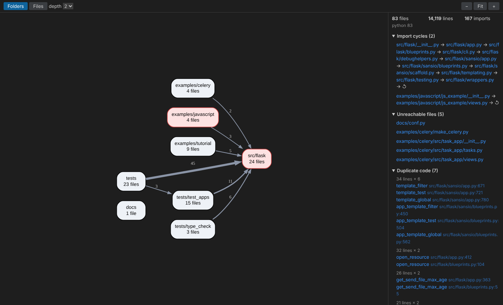
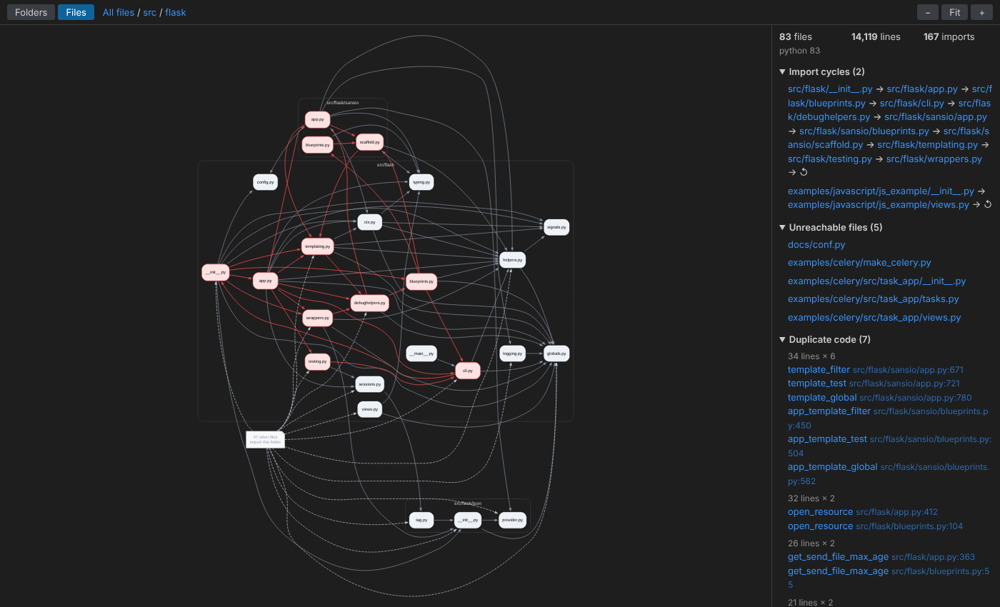

# Stratum

Maps large codebases into interactive architecture diagrams.

Stratum is a VS Code extension backed by a Python analysis engine. It parses a repository with [Tree-sitter](https://tree-sitter.github.io/), builds the file-level import graph, and shows it inside VS Code alongside the problems it finds: import cycles, unreachable files, duplicated functions, and overly complex code. It re-analyzes incrementally as you save, and can generate documentation with an LLM.

Supported languages: **Python, JavaScript, TypeScript (incl. TSX), Go, Java**.





## What it finds

| Finding | How |
|---|---|
| **Dependency graph** | Imports are resolved to repo files per language: Python packages and `src/` layouts, relative JS/TS with Node's extension and `index` lookups, Go packages via `go.mod`, Java classes and wildcards. Type-only imports (`if TYPE_CHECKING:`, `import type`) are ignored because they never run. |
| **Import cycles** | Strongly connected components of the graph via an iterative **Tarjan's algorithm** (O(V + E), no recursion limit). |
| **Unreachable files** | BFS from detected entry points (`__main__` guards, `public static void main`, `package main`, tests, `main.*`/`index.*`). Go packages and Python `__init__.py` follow their languages' loading rules. |
| **Duplicate functions** | Each function's syntax tree is hashed with identifiers → `ID` and literals → `LIT`, so copies with renamed variables or different constants still match. Comments and formatting are ignored. |
| **Complex functions** | Cyclomatic complexity: 1 + branches, loops, cases, catches, ternaries and `&&`/`||`. |
| **Coupling** | Fan-in / fan-out per file. Most-imported files are your hotspots. |

## Performance

Full scan vs. re-analysis after editing one file (median of 15 edits), measured with `benchmarks/bench_incremental.py` on a 2-vCPU cloud VM:

| Repository | Size | Full scan | 1-file update |
|---|---|---|---|
| pallets/flask | 14K LOC, Python | 0.24 s | 5 ms |
| nestjs/nest | 204K LOC, TypeScript | 3.0 s | 19 ms |
| gohugoio/hugo | 206K LOC, Go | 4.1 s | 21 ms |
| django/django | 466K LOC, Python | 8.9 s | 40 ms |
| google/guava | 711K LOC, Java | 12.5 s | 108 ms |

The engine stays running and keeps every file's parse result in memory. On save it re-parses only files whose content hash changed and re-resolves only their imports. The resolver's indexes are rebuilt only when module identity changes (a file added or removed, a package line, `__init__.py`, `go.mod`). Parsing is about 98% of a full scan, so skipping it is where the speedup comes from.

## Getting started

```bash
git clone https://github.com/Harish-613/stratum && cd stratum
python3 -m venv .venv && .venv/bin/pip install -e engine     # engine + Tree-sitter grammars
cd extension && npm install && npm run compile
```

Open the `extension/` folder in VS Code and press **F5**. In the Extension Development Host window that opens, open any project and run:

- **Stratum: Analyze Workspace**: scans the project and opens the graph
- **Stratum: Show Dependency Graph**: reopens it
- **Stratum: Generate Docs (LLM)**: see below

In the graph view, click a file to open it or a folder to drill in, and hover to highlight a file's edges. The breadcrumbs take you back out. Repos over 150 files open at folder level; switch with **Folders / Files**. Every entry in the sidebar jumps to the file and line.

The extension uses `../.venv/bin/python` when it exists and `python3` otherwise. Override this with the `stratum.pythonPath` and `stratum.enginePath` settings.

### Command line

The engine works without VS Code:

```bash
.venv/bin/stratum analyze path/to/repo > report.json           # full JSON report
.venv/bin/stratum dot path/to/repo | dot -Tsvg > graph.svg      # Graphviz
.venv/bin/stratum docs path/to/repo --dry-run                   # chunk plan, no LLM calls
ANTHROPIC_API_KEY=... .venv/bin/stratum docs path/to/repo       # write .stratum/docs/
```

## LLM documentation

`stratum docs` (or **Stratum: Generate Docs**) writes Markdown to `.stratum/docs/`:

1. **Chunk at AST boundaries.** Each file is split into runs of whole top-level statements (imports, functions, classes) under a token budget of 1,500 by default. An oversized class is split between its methods, with the class header kept on the first piece. Only a single statement larger than the budget is cut by lines.
2. **Summarize** each chunk, then combine the chunk notes into one summary per file. The prompt includes the file's position in the graph (what it imports and how many files import it).
3. **ARCHITECTURE.md** is written from the file summaries plus engine facts: most-imported files, entry points, and cycles.

Every response is cached in `.stratum/cache.json`, keyed by a hash of its prompt. Re-running after an edit only calls the LLM for chunks whose code changed, plus that file's summary and the architecture doc. Anthropic (default) and OpenAI are supported over plain HTTPS, with no SDK needed. In VS Code the key lives in VS Code's encrypted secret storage.

## How it's built

```
extension/ (TypeScript)                         engine/ (Python)
  extension.ts   commands, file watcher  ─┐       languages.py  extension → Tree-sitter grammar
  engine.ts      JSON-lines client      ──┼──►    parse.py      imports, functions, classes, entry points
  graphPanel.ts  webview + CSP            │       metrics.py    AST hash, cyclomatic complexity
  media/graph.js Graphviz (WASM), pan/zoom│       resolve.py    import → repo file, per language
                                          │       graph.py      Tarjan SCC, reachability, entry points
                                          │       analyze.py    report, DOT (files / folders / focus)
                     stdin/stdout ────────┘       session.py    incremental state
                                                  server.py     `stratum serve` protocol
                                                  docs.py       AST chunking + LLM pipeline + cache
```

The extension spawns `python -m stratum_engine.cli serve` once and exchanges newline-delimited JSON (`open`, `update`, `report`, `dot`, `docs`, `shutdown`). The webview renders DOT client-side with Graphviz compiled to WebAssembly, so nothing needs to be installed beyond the Python packages.

## Tests

```bash
.venv/bin/python -m pytest engine          # 56 engine tests
cd extension && npm run test:engine        # drives the real engine through EngineClient
```

Highlights: Tarjan is checked against brute-force reachability on random graphs; incremental results are checked against a from-scratch analysis after edits, creations and deletions; the LLM pipeline runs against a fake model to verify chunk boundaries, caching and partial re-runs. CI runs both suites on every PR.

## Limitations

- Only imports create edges. Same-package references in Go and Java and dynamic imports with computed paths aren't seen, and TS path aliases (`@/...`) aren't resolved yet.
- Dead-code detection works at the file level, and only when entry points are detected.
- Duplicate detection finds whole functions that are structurally identical, not partial overlaps.
